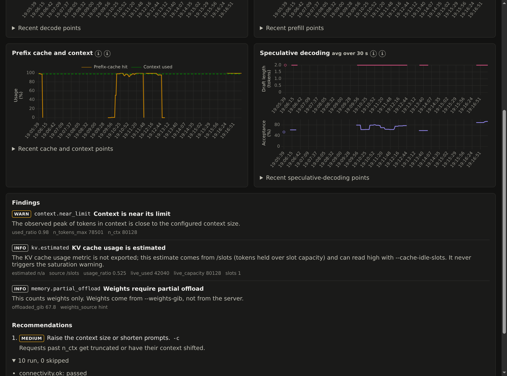

# llama-doctor

A command-line tool that reads a local LLM server's metrics and tells you what is misconfigured.

[](https://github.com/msalsas/llama-doctor/actions/workflows/ci.yml)
[](https://www.python.org/downloads/)
[](LICENSE)


The live dashboard on an RTX 5080 rig running Unsloth Studio, serving Qwen3.8-Flash-Next-GGUF.

## What it does

- Reads `/metrics`, `/props` and `/v1/models` over HTTP. It never attaches to, restarts or reconfigures the server process.
- Runs 10 analyzers that emit 43 distinct findings across connectivity, prefill and decode throughput, memory, cache, context sizing, request queueing, speculative decoding, quantization and expert offload.
- Ranks recommendations by impact and names the server flag to change.
- Returns an exit code per severity, so you can gate CI jobs or cron checks on it.
- Optionally serves a local dashboard with live charts and findings.

It works with llama.cpp's server and forks that expose the same `llamacpp:` metrics namespace. It has been tested against Unsloth Studio's llama.cpp builds.

## Install

Requires Python 3.10 or newer. There are no runtime dependencies; it uses the standard library only.

```sh
git clone https://github.com/msalsas/llama-doctor.git
cd llama-doctor
pip install -e .
```

To run it without installing anything, from the repository root (the `PYTHONPATH=src` commands only resolve the package from there):

```sh
PYTHONPATH=src python3 -m llama_doctor diagnose http://127.0.0.1:8080
```

## Quick start

Point it at a running server. A plain llama.cpp server needs only the URL (for example `http://127.0.0.1:8080`); wrappers that require an API key, such as Unsloth Studio, take it from an environment variable via `--api-key-env`:

```sh
llama-doctor diagnose http://laptop-msi:8888 --api-key-env UNSLOTH_API_KEY
```

```text
llama-doctor 0.1.0  http://laptop-msi:8888
model  Qwen3.8-Flash-Next-GGUF  quant UD-Q3_K_XL  ctx 80128  slots 1  build unsloth-studio/v0.1.908-beta

rates (lifetime averages)
  prefill       135.2 tok/s
  decode        24.6 tok/s
  prefix cache  96.7 %
  drafts        len 2.00  acceptance 64.6 %

findings
  WARN context.near_limit  Context is near its limit
        The observed peak of tokens in context is close to the configured context size.
  OK   connectivity.ok  Endpoints available
  OK   decode.ok  Decode throughput is healthy
  OK   prefix_cache.ok  Prefix cache is effective
  OK   queue.ok  No requests queued
  OK   spec.ok  Speculative decoding is healthy
  OK   props.ok  Properties raise no issue
  N/A  prefill.insufficient_data  Prefill rate cannot be judged
        Prefill measures 135 tok/s, under 300 tok/s, but 97 % of prompt tokens come from the prefix cache, so the lifetime rate mixes short uncached tails with any large uncached prompt and cannot tell them apart. Run --probe for a cache-free measurement, or watch it under serve, whose window shows the uncached tokens per request.
  N/A  kv.insufficient_data  KV cache data unavailable
        The KV cache usage metric is not exported.
  N/A  memory.insufficient_data  Memory estimate unavailable
        Provide --vram-gib and optionally --ram-gib.
recommendations (by impact)
  1. medium Raise the context size or shorten prompts.  [-c]
overall: WARN (exit 1)
```

Findings are sorted by severity, then by the impact of their recommendations. OK findings print without a detail line. Prefill here runs at 135 tok/s, under the 300 tok/s threshold, yet is not flagged: 96.7 % of prompt tokens come from the prefix cache, so the lifetime rate mixes short uncached tails with any large uncached prompt and `prefill.insufficient_data` (N/A) is reported instead. `prefill.slow` (WARN) fires only when the prefix-cache hit is under 50 % or unknown.

Recommendations that name the same flag stay separate when their actions differ, so one finding asking to shrink `-c` and another asking to raise it both show up.

Exit codes: `0` = OK, `1` = WARN, `2` = CRIT (including server unreachable), `3` = invalid usage or arguments.

## Dashboard

```sh
llama-doctor serve http://127.0.0.1:8080
```

`serve` runs a local HTTP server on port 8765; open `http://127.0.0.1:8765` in a browser. It polls the llama.cpp server every 2 s and keeps the last 300 points in memory. Chart rates are computed over a sliding 30 s window (`--rate-window`), because llama.cpp counters only move when a request completes.

Tiles, left to right: Decode tok/s, Prefill tok/s, Prefix-cache hit, Context, Queue.

- Decode, Prefill and Prefix-cache hit show the latest windowed value, with the lifetime average below it (or only the lifetime average while the server is idle).
- Current llama-server builds and Unsloth Studio do not export a KV usage gauge, so the dashboard has no KV tile. Older builds that still export `kv_cache_usage_ratio` keep the KV findings (`kv.saturated` warns at 90 % or more of the real gauge; `kv.estimated` appears when only `/slots` is readable).
- Context shows the peak tokens held in context as a share of `n_ctx` (`n_tokens_max / n_ctx`, for example `98.0 %` and `78.5k / 80.1k`). The peak is the highest point since the server started, not live use; when `/slots` is readable the tile reads `live X % - peak Y %`, where live is the tokens held by the slots right now (prompt plus decoded) over their summed `n_ctx`. `context.near_limit` warns at 90 % or more.
- Queue shows requests being processed and, below it, requests deferred while waiting for a free slot (`requests_processing`, `requests_deferred`).

Charts:

- Decode throughput and Prefill throughput, in tokens per second, averaged over the rate window.
- Prefix cache and context, in percent: Prefix-cache hit, and Context used as a dashed line (a peak, not a live gauge).
- Speculative decoding: Draft length in tokens and Draft acceptance in percent, averaged over the rate window.

Every tile, chart and the quant, context and slots fields in the header have a help tooltip that says what the value measures and how to read it, independent of model or hardware.


The findings and recommendations panels re-run every analyzer on each poll, so a change to your server flags shows up within one interval. The dashboard binds to `127.0.0.1` by default and loads no external resources: no CDNs, fonts or analytics.

## CLI reference

`llama-doctor diagnose URL`

| Flag | Effect |
| --- | --- |
| `--json` | Print findings as JSON instead of text. |
| `--probe` | Send a warm-up and one synthetic completion request to measure real latency. |
| `--vram-gib N` | GPU memory available, used by the memory estimate. |
| `--ram-gib N` | System RAM available for offloaded weights. |
| `--weights-gib N` | Model weight size in GiB, used only when the server does not report it; the memory finding then shows `weights_source: hint`. |
| `--api-key-env VAR` | Read the server's API key from environment variable `VAR`. |
| `--timeout SEC` | HTTP timeout per request. |
| `--no-color` | Disable ANSI colour in text output. |
| `--no-slots` | Do not read `GET /slots` (live context and the KV estimate in findings). Without this flag it is read with the same auth as `/metrics`; any failure just leaves those values out. Only token counts are used; prompt text and ids are never kept. |

`--probe` is off by default. It is the only option that sends a write request to the server; everything else is a read-only GET.

`llama-doctor serve URL`

| Flag | Effect |
| --- | --- |
| `--host` | Address to bind (default `127.0.0.1`). |
| `--port` | Port to listen on (default `8765`). |
| `--interval` | Seconds between polls (default `2.0`). |
| `--history` | Number of points kept for the charts (default `300`). |
| `--rate-window SEC` | Seconds over which chart rates and the queue check are computed (default `30.0`). |
| `--vram-gib N` | GPU memory available, same as in `diagnose`; without it the memory check stays N/A on the dashboard. |
| `--ram-gib N` | System RAM available for offloaded weights, same as in `diagnose`. |
| `--weights-gib N` | Model weight size in GiB, same as in `diagnose`; the size reported by the server wins when present. |
| `--no-slots` | Do not poll `GET /slots`, same as in `diagnose`; the context tile then shows only the peak. |

`serve` also accepts `--api-key-env` and `--timeout`.

## Checks

The analyzers cover connectivity, server properties, prefill throughput, decode throughput, prefix cache, KV cache usage, context window (near the limit or oversized), request queue, speculative decoding, and memory (including quantization and expert offload). The modules in [`src/llama_doctor/analysis/`](src/llama_doctor/analysis/) are the source of truth for each finding and its threshold.



Two findings that the server above does not trigger but other setups do:

- `prefix_cache.low_hit_ratio` (WARN below 20 %): for example, only 10.3 % of prompt tokens came from the cache. The fix is to keep the prompt prefix byte-identical across requests and enable `--cache-reuse`.
- `context.oversized` (WARN when the peak is under 25 % of a context of 16384 tokens or more): for example, the server reserves a 32768-token context but the peak is 5.5k tokens. The suggested size is twice the peak rounded up to a multiple of 4096, so `-c 12288` frees KV cache memory.

## Development

```sh
python3 -m venv .venv
. .venv/bin/activate
pip install -e . ruff
python3 -m unittest discover -v
ruff check src tests
```

Pull requests are welcome.

## License

MIT. See [LICENSE](LICENSE).
