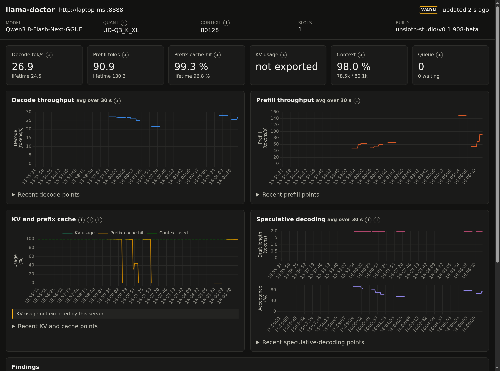
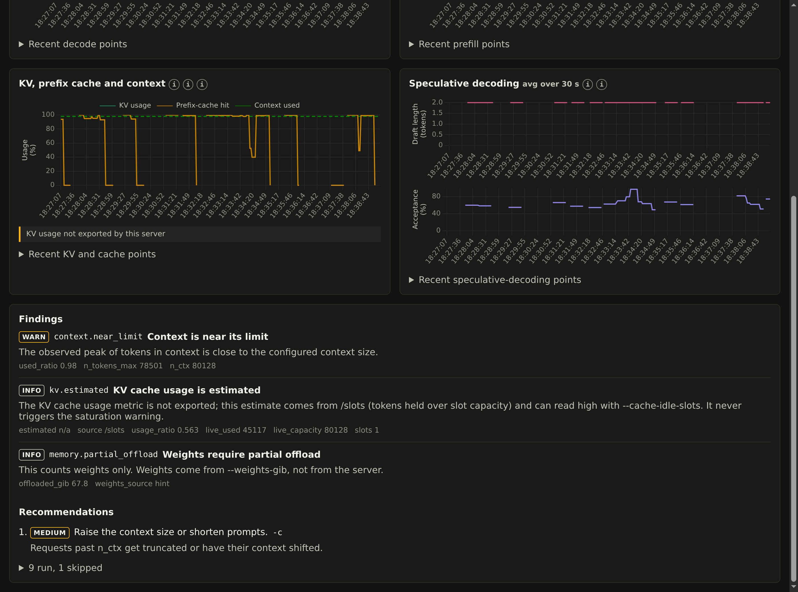

# llama-doctor

A command-line tool that reads a local LLM server's metrics and tells you what is misconfigured.

[](https://github.com/msalsas/llama-doctor/actions/workflows/ci.yml)
[](https://www.python.org/downloads/)
[](LICENSE)



The live dashboard on an RTX 5080 rig running Unsloth Studio, serving Qwen3.8-Flash-Next-GGUF.

## What it does

- Reads `/metrics`, `/props` and `/v1/models` over HTTP. It never attaches to, restarts or reconfigures the server process.
- Runs 10 analyzers that emit 41 distinct findings across connectivity, memory, cache, context sizing, speculative decoding, quantization and expert offload.
- Ranks recommendations by impact and names the server flag to change.
- Returns an exit code per severity, so you can gate CI jobs or cron checks on it.
- Optionally serves a local dashboard with live charts and findings.

It works with llama.cpp's server and forks that expose the same `llamacpp:` metrics namespace. It has been tested against Unsloth Studio's llama.cpp builds.

## Install

Requires Python 3.10 or newer. There are no runtime dependencies; it uses the standard library only.

```sh
git clone https://github.com/msalsas/llama-doctor.git
cd llama-doctor
pip install .
```

To run it without installing anything:

```sh
PYTHONPATH=src python3 -m llama_doctor diagnose http://127.0.0.1:8080
```

## Quick start

Point it at a running server. A plain llama.cpp server needs only the URL (for example `http://127.0.0.1:8080`); wrappers that require an API key, such as Unsloth Studio, take it from an environment variable via `--api-key-env`:

```sh
llama-doctor diagnose http://laptop-msi:8888 --api-key-env UNSLOTH_API_KEY
```

```text
llama-doctor 0.1.0  http://laptop-msi:8888
model  Qwen3.8-Flash-Next-GGUF  quant UD-Q3_K_XL  ctx 80128  slots 1  build unsloth-studio/v0.1.908-beta

rates (lifetime averages)
  prefill       135.2 tok/s
  decode        24.6 tok/s
  prefix cache  96.7 %
  drafts        len 2.00  acceptance 64.6 %

findings
  INFO prefill.slow  Prefill is slow
        Prefill throughput is below the expected range.
  OK   connectivity.ok  Endpoints available
  OK   decode.ok  Decode throughput is healthy
  OK   prefix_cache.ok  Prefix cache is effective
  OK   kv.ok  KV cache sizing is healthy
  OK   spec.ok  Speculative decoding is healthy
  N/A  memory.insufficient_data  Memory estimate unavailable
        Provide --vram-gib and optionally --ram-gib.
  N/A  props.minimal  Properties are minimal
        Wrapper builds such as unsloth-studio omit required fields.
recommendations (by impact)
  1. medium Increase micro-batch size.  [--ubatch-size]
overall: INFO (exit 0)
```

Exit codes: `0` = OK, `1` = WARN, `2` = CRIT (including server unreachable), `3` = invalid usage or arguments.

## Dashboard

```sh
llama-doctor serve http://127.0.0.1:8080
```

`serve` runs a local HTTP server on port 8765; open `http://127.0.0.1:8765` in a browser. It polls the llama.cpp server every 2 s and keeps the last 300 points in memory.

- Every metric has a help tooltip that says what it measures and how to read it.
- A Queue tile shows requests being processed and requests deferred while waiting for a free slot (`requests_processing`, `requests_deferred`).
- A Context tile shows the peak tokens held in context as a share of `n_ctx` (`n_tokens_max / n_ctx`, for example `98.0 %` and `78.5k / 80.1k`). It is the highest point since the server started, not live use. The KV chart plots the same ratio as a dashed line, and `context.near_limit` warns at 90 % or more.



The findings and recommendations panels re-run every analyzer on each poll, so a change to your server flags shows up within one interval. The dashboard binds to `127.0.0.1` by default and loads no external resources: no CDNs, fonts or analytics.

## CLI reference

`llama-doctor diagnose URL`

| Flag | Effect |
| --- | --- |
| `--json` | Print findings as JSON instead of text. |
| `--probe` | Send a warm-up and one synthetic completion request to measure real latency. |
| `--vram-gib N` | GPU memory available, used by the memory estimate. |
| `--ram-gib N` | System RAM available for offloaded weights. |
| `--api-key-env VAR` | Read the server's API key from environment variable `VAR`. |
| `--timeout SEC` | HTTP timeout per request. |
| `--no-color` | Disable ANSI colour in text output. |

`--probe` is off by default. It is the only option that sends a write request to the server; everything else is a read-only GET.

`llama-doctor serve URL`

| Flag | Effect |
| --- | --- |
| `--host` | Address to bind (default `127.0.0.1`). |
| `--port` | Port to listen on (default `8765`). |
| `--interval` | Seconds between polls (default `2.0`). |
| `--history` | Number of points kept for the charts (default `300`). |

`serve` also accepts `--api-key-env` and `--timeout`.

## Checks

The analyzers cover connectivity, server properties, prefill throughput, decode throughput, prefix cache, KV cache and context sizing, speculative decoding, and memory (including quantization and expert offload). The modules in [`src/llama_doctor/analysis/`](src/llama_doctor/analysis/) are the source of truth for each finding and its threshold.

Two findings from the output above:

- `prefix_cache.low_hit_ratio`: only 10.3 % of prompt tokens came from the cache. The fix is to keep the prompt prefix byte-identical across requests and enable `--cache-reuse`.
- `kv.context_oversized`: the server reserves a 32768-token context, but observed peak use is far lower. Setting `-c 12288` frees KV cache memory.

## Development

```sh
python3 -m venv .venv
. .venv/bin/activate
pip install -e . ruff
python3 -m unittest discover -v
ruff check src tests
```

Pull requests are welcome.

## License

MIT. See [LICENSE](LICENSE).
